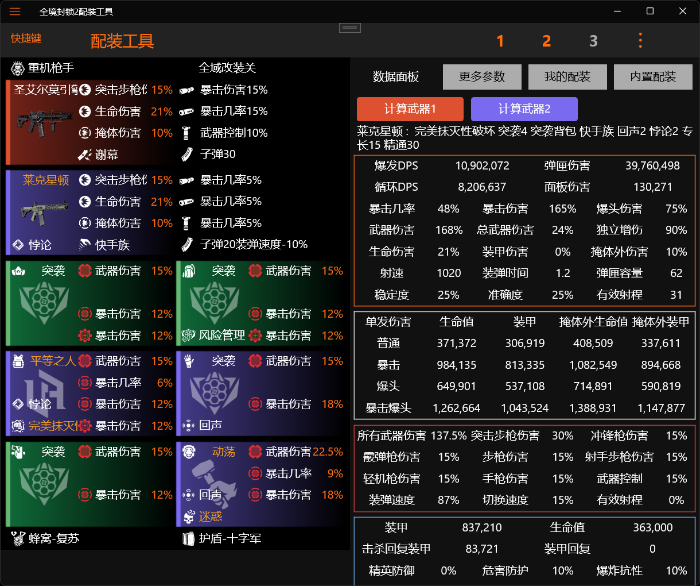

# 全境封锁2配装工具

《全境封锁2》配装编辑与伤害计算工具，提供网页版和客户端版（Windows、Android、iOS、macOS）。

- 配装工具Web版：https://division2buildtool.github.io/build/
- 配装工具App版：https://division2buildtool.github.io/app/
- 项目主页：https://division2buildtool.github.io/

> 本工具与 Ubisoft、Massive Entertainment 无关。

## 主要功能

- **配装编辑**：3 把武器、6 件装备，以及天赋、词条、配件、专长、技能、全域改装等自由搭配
- **伤害计算**：DPS、单发伤害（含猎头）、暴击、爆头、技能属性等结果，支持自动与手动计算
- **配装管理**：保存/加载配装，支持文件导入导出、分享链接与二维码
- **资料库**：武器数据、天赋列表、品牌加成、奇特/具名装备、装备搜索

## 快速开始

1. 网页版打开[配装工具Web版](https://division2buildtool.github.io/build/)；客户端版从[配装工具App版](https://division2buildtool.github.io/app/)下载安装。
2. 选择武器和装备，按需调整天赋、词条、技能与更多参数。
3. 在结果面板查看计算；网页版可用 `F1` ~ `F4` 切换面板。
4. 需要保存时点击“保存配装”，需要发给别人时使用分享链接或二维码。

计算规则与参数说明见[软件使用简介](https://division2buildtool.github.io/introduction/)。

## 配装分享

- **分享链接**：点击“复制配装链接”，格式为 `https://division2buildtool.github.io/b/{code}`。对方打开后会自动应用这套配装。
- **二维码**：可生成当前配装的二维码，也可上传二维码图片导入配装；App 版还支持识别截图中的二维码。
- **图片导出**：可保存配装图片、保存含计算数据的图片，或复制配装图片。
- **文件导入导出**：可把配装导出为文件，或从文件导入。

## 网页版快捷键

配装页支持以下快捷键，点击页面上的 `?` 也可以查看：

| 按键 | 功能 |
| --- | --- |
| `1` / `2` / `3` | 打开武器选择 |
| `Shift` + `1` / `2` / `3` | 显示或隐藏对应武器 |
| `Q` `W` `A` `S` `Z` `X` | 选择六件装备 |
| `Alt` + `1` ~ `3` | 计算对应武器 |
| `F1` ~ `F4` | 切换结果面板 |
| `Ctrl` + `S` | 保存配装 |
| `?` | 打开快捷键说明 |
| `Esc` | 关闭弹层 |

## 客户端系统要求

| 系统 | 最低版本要求 | 推荐版本要求（部分功能需求） |
| --- | --- | --- |
| Windows (x64) | Windows 10 版本 1809 | Windows 10 版本 1809 |
| Android | Android 5.0 | Android 7.0 |
| iOS | iOS 11 | iOS 14 |
| macOS | macOS 10.15 | macOS 11 |

## 客户端下载与安装

- [GitHub Releases](https://github.com/division2buildtool/division2buildtool.github.io/releases)：如果下载较慢，可以复制文件链接，使用 [GitHub 文件加速1](https://gh.llkk.cc/) 或 [GitHub 文件加速2](https://github.akams.cn/) 下载。
- [蓝奏云](https://wwbb.lanzout.com/b03vesg4h)，密码：3z9a。移动端下载 apk/ipa 文件时，若提示需要会员，将手机浏览器切换为桌面模式即可下载。
- Windows 安装步骤与常见问题见[Windows 系统安装说明](https://division2buildtool.github.io/app/#windows-install)。
- iOS 的 ipa 安装包未签名，需要自签后安装，请自行搜索相关教程。

## 使用提示

- 网页版配装数据保存在当前浏览器中；更换设备或清理浏览器数据前，建议导出文件或生成分享链接。
- 网页版切换语言后需要刷新页面，界面文本才会全部更新。
- 网页版首次联网加载后，已缓存的页面可以离线打开。
- 玩家数据查询、应用更新检查和安装包下载仅客户端提供。

## 数据参考和图片素材来源

- [Hunter - The TD2, AFOP, XDefiant Asset Extractor](https://dtzxporter.com/tools/hunter)
- [The Division 2: Weekly Vendor Reset - Ruben Alamina](https://rubenalamina.mx/the-division-weekly-vendor-reset/)
- [The Division 2 Stats](https://tracker.gg/division-2)
- [Ubisoft Help](https://www.ubisoft.com/zh-cn/help/game/the-division-2)
- [全境封锁2 TU17敌怪【血量统计】](https://www.bilibili.com/video/BV1C84y1P7Cr)
- [TU19猎头者伤害公式](https://tieba.baidu.com/p/8809994501)
- [Division 2 Build Making Tool](https://drive.google.com/drive/folders/1Y2To9xV33vXuI6QSQhVG6zT6vE-hh2Hv)
- [Division 2 Gear Attribute Sheet](https://docs.google.com/spreadsheets/d/e/2PACX-1vTJEX5DerCvOj3a_m36TRy1gPBAUvrduOIdmXI9j1Y0MpQk1wIXaZ9KOcPa7HzXzp_N5qGmjDj6yEfL/pubhtml)
- [Division 2 Gear Spreadsheet](https://docs.google.com/spreadsheets/d/1nrPBmOrtpkEW1j5fbcRT7L-AXgsGOqMqxXoVtopsiGM)

## 感谢以下开源项目

- [.NET MAUI - MIT License](https://github.com/dotnet/maui)
- [ASP.NET Core Blazor - MIT License](https://github.com/dotnet/aspnetcore)
- [CommunityToolkit.Maui - MIT License](https://github.com/CommunityToolkit/Maui)
- [CommunityToolkit.Mvvm - MIT License](https://github.com/CommunityToolkit/dotnet)
- [SkiaSharp - MIT License](https://github.com/mono/SkiaSharp)
- [LocalizationResourceManager.Maui - MIT License](https://github.com/SirJohnK/LocalizationResourceManager.Maui)
- [Mopups - BSD-3-Clause License](https://github.com/LuckyDucko/Mopups)
- [Newtonsoft.Json - MIT License](https://github.com/JamesNK/Newtonsoft.Json)
- [ZXing.Net - Apache License](https://github.com/micjahn/ZXing.Net/)
- [QRCoder - MIT License](https://github.com/Shane32/QRCoder)

> 本软件为个人开发作品，仅供学习交流使用。游戏数据和素材版权归 Ubisoft 所有。
